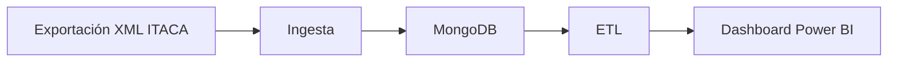
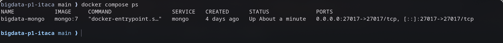
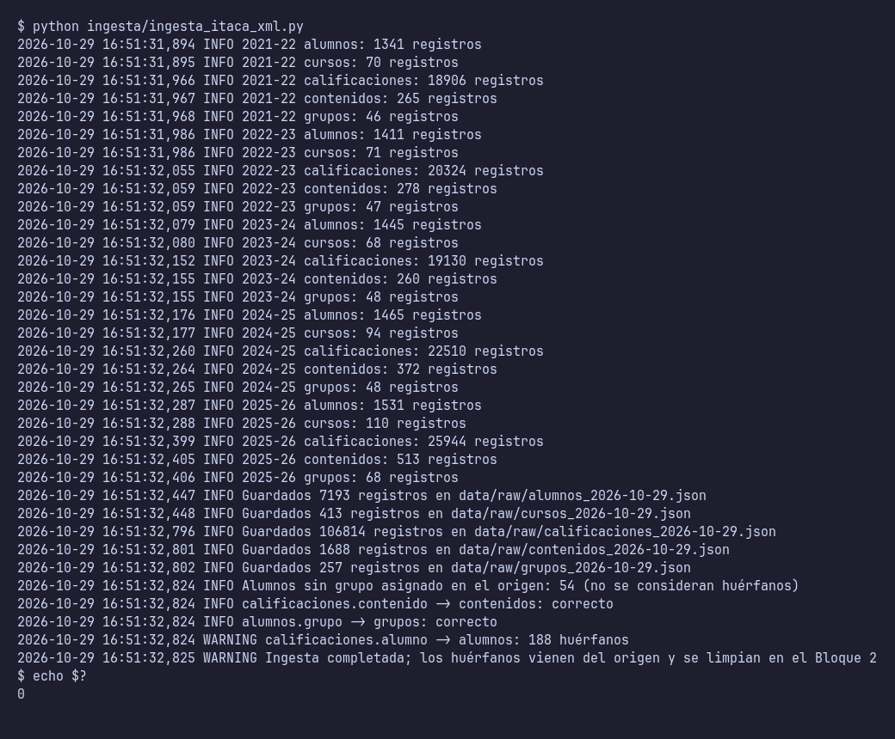
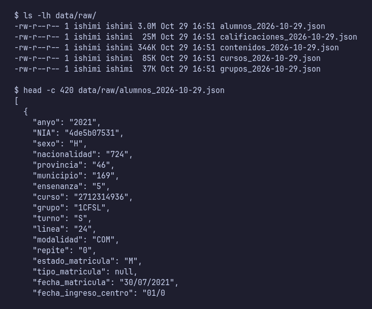

# Proyecto 1 · Analítica académica ITACA (origen XML)

> Proyecto del módulo **Big Data aplicado** (IABD). Dashboard de análisis académico en Power BI a partir de datos de ITACA exportados como XML. Arquitectura batch.

## Descripción y objetivo

Ingestar las exportaciones XML de ITACA, almacenarlas y transformarlas en un modelo de datos que alimente un dashboard académico.

## Arquitectura



*Diagrama provisional (Bloque 0). Se actualizará al terminar cada bloque.*

## Fuentes de datos

| Fuente | URL / origen | Formato | Frecuencia de actualización | Licencia | Última ingesta |
|---|---|---|---|---|---|
| ITACA (exportación) | `data/exportaciones/<curso>/<tabla>.xml` (cursos 2021-22 a 2025-26) | XML | Una exportación por curso académico; se renueva al cerrar cada curso (la de 2025-26 se refresca en cada evaluación) | Uso docente (datos de ejemplo anonimizados por el docente) | 2026-10-28 |

### Tablas de origen

Acceso: exportación XML de ITACA, un fichero por tabla y curso; cada registro es un elemento con los datos como atributos.

| Tabla | Elemento XML | Campos que se ingestan | Campos descartados |
|---|---|---|---|
| Alumnos | `alumno` | NIA (anonimizado), sexo, nacionalidad, provincia, municipio, ensenanza, curso, grupo, turno, linea, modalidad, repite, estado_matricula, tipo_matricula, fecha_matricula, fecha_ingreso_centro | Nombre, apellidos, fecha y lugar de nacimiento, documento, contacto, dirección, SIP, expediente… (datos personales) |
| Cursos | `curso` | codigo, nombre_cas, nombre_val, abreviatura, ensenanza, padre | — |
| Calificaciones | `calificacion` | evaluacion, alumno (NIA anonimizado), ensenanza, curso, contenido, bloque_contenido, nota_numerica, tipo_nota | — |
| Contenidos (módulos) | `contenido` | codigo, nombre_cas, nombre_val, ensenanza, curso | — |
| Grupos | `grupo` | codigo, nombre, turno, linea, modalidad | aula, capacidad |

A todas se les añade `anyo` (atributo `curso` del elemento raíz).

## Estructura del repositorio

| Carpeta | Contenido |
|---|---|
| `ingesta/` | Scripts de lectura de los XML |
| `etl/` | Transformaciones y modelo de datos |
| `dashboard/` | Informe de Power BI |
| `docs/` | Capturas y diagramas |
| `docker-compose.yml` | Servicio MongoDB local para desarrollo |

## Cómo desplegar el entorno

```bash
docker compose up -d
docker compose ps
```

MongoDB queda expuesto en `localhost:27017`.

## Bitácora de prácticas

### Bloque 0 · Entorno

- Objetivo: dejar preparado el repositorio y un MongoDB local con Docker.
- Pasos realizados: creación del repo con la estructura de la práctica, `.gitignore` del módulo, `docker-compose.yml` con MongoDB 7, primer commit y publicación en GitHub.
- Problemas encontrados y solución: —
- Resultado: `docker compose ps` con el contenedor `bigdata-mongo` en ejecución.

  

### Bloque 1 · Ingesta batch

- Objetivo: primera ingesta de los XML de ITACA (cinco cursos académicos) a la zona `raw` como JSON, con el NIA anonimizado.
- Pasos realizados:
  1. Análisis de la fuente (sección «Fuentes de datos»).
  2. Entorno: Python con sólo biblioteca estándar (`xml.etree`, `hashlib`, `json`); los XML se colocan en `data/exportaciones/<curso>/`.
  3. `ingesta/ingesta_itaca_xml.py`: recorre cada curso y tabla, extrae los campos del enunciado (con sus mismos nombres), anonimiza y guarda `data/raw/<tabla>_<fecha>.json`. Usa `logging` y errores controlados (fichero que falta o XML mal formado → mensaje y código de salida 1).
  4. Anonimización del NIA: hash **HMAC-SHA256** con una sal secreta guardada en `data/.sal_nia` (fuera de Git), truncado a 10 hex. Se calcula una sola vez por NIA (caché) y se reutiliza en Alumnos y Calificaciones.
  5. Validación de integridad al final de la ejecución.
  6. Comprobado que en `data/raw/` no hay nombre, apellidos, documento ni email, y que el NIA original no aparece.
- Problemas encontrados y solución:
  - El enunciado habla de cuatro y de cinco tablas (y menciona `horas`, que no existe en la exportación). Se ingestan las cinco que hay: `alumnos`, `cursos`, `calificaciones`, `contenidos` y `grupos`.
  - El esqueleto del enunciado lee elementos hijos (`findtext`), pero el XML real usa atributos: se leen con `nodo.get()`. Los campos de salida llevan exactamente los nombres del enunciado.
  - Los campos de `alumnos` que pide el enunciado incluyen municipio y fechas de matrícula; son cuasi-identificadores, así que no se publican (`data/` está fuera de Git). Se descartan nombre, apellidos, documento, contacto, SIP y fechas de nacimiento.
  - Un hash simple de un NIA de 8 cifras se deshace probando todos los valores; por eso se añade la sal.
  - 54 alumnos no tienen grupo en el origen: se guardan con `Grupo = null` y no cuentan como huérfanos.
  - 188 calificaciones de 2023 (9 NIA) no tienen su alumno en `alumnos.xml` de ese curso: es un hueco del origen. No se descartan; queda anotado para la limpieza del Bloque 2.
- Resultado: 5 tablas en `data/raw/` (7 193 alumnos, 413 cursos, 106 814 calificaciones, 1 688 contenidos, 257 grupos). Todo `contenido` de Calificaciones existe en Contenidos y todo `grupo` de Alumnos existe en Grupos. Salida de la ejecución en [`docs/salida-ingesta.txt`](docs/salida-ingesta.txt) y en las capturas:

  

  

  Los JSON de `data/raw/` no se suben a Git (están en `.gitignore`); se entregan sólo como evidencia local.

## Decisiones técnicas

| Decisión | Alternativa descartada | Motivo |
|---|---|---|
| MongoDB 7 en Docker para el origen XML | Cargar los XML en PostgreSQL | Los documentos XML se almacenan de forma natural como documentos BSON |

## Incidencias resueltas

*Ninguna por ahora.*
