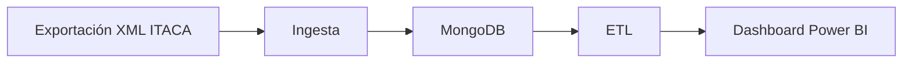

# Proyecto 1 · Analítica académica ITACA (origen XML)

> Proyecto del módulo **Big Data aplicado** (IABD). Dashboard de análisis académico en Power BI a partir de datos de ITACA exportados como XML. Arquitectura batch.

## Descripción y objetivo

Ingestar las exportaciones XML de ITACA, almacenarlas y transformarlas en un modelo de datos que alimente un dashboard académico.

## Arquitectura



*Diagrama provisional (Bloque 0). Se actualizará al terminar cada bloque.*

## Fuentes de datos

| Fuente | URL / origen | Formato | Frecuencia de actualización | Licencia | Última ingesta |
|---|---|---|---|---|---|
| ITACA (exportación) | Fichero XML exportado de ITACA | XML | Única (práctica) | Uso docente | — |

## Estructura del repositorio

| Carpeta | Contenido |
|---|---|
| `ingesta/` | Scripts de lectura de los XML |
| `etl/` | Transformaciones y modelo de datos |
| `dashboard/` | Informe de Power BI |
| `docs/` | Capturas y diagramas |
| `docker-compose.yml` | Servicio MongoDB local para desarrollo |

## Cómo desplegar el entorno

```bash
docker compose up -d
docker compose ps
```

MongoDB queda expuesto en `localhost:27017`.

## Bitácora de prácticas

### Bloque 0 · Entorno

- Objetivo: dejar preparado el repositorio y un MongoDB local con Docker.
- Pasos realizados: creación del repo con la estructura de la práctica, `.gitignore` del módulo, `docker-compose.yml` con MongoDB 7, primer commit y publicación en GitHub.
- Problemas encontrados y solución: —
- Resultado: `docker compose ps` con el contenedor `bigdata-mongo` en ejecución.

  

### Bloque 1 · Ingesta batch

- Objetivo: —
- Pasos realizados: —
- Problemas encontrados y solución: —
- Resultado: —

## Decisiones técnicas

| Decisión | Alternativa descartada | Motivo |
|---|---|---|
| MongoDB 7 en Docker para el origen XML | Cargar los XML en PostgreSQL | Los documentos XML se almacenan de forma natural como documentos BSON |

## Incidencias resueltas

*Ninguna por ahora.*
